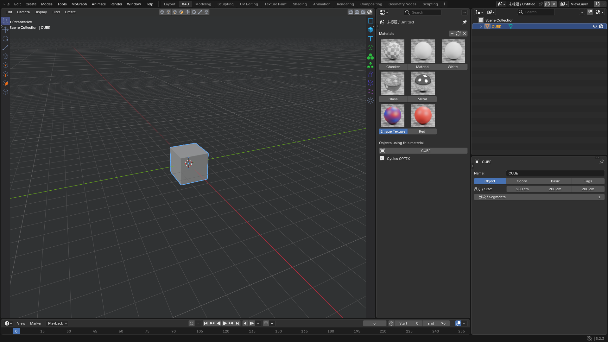
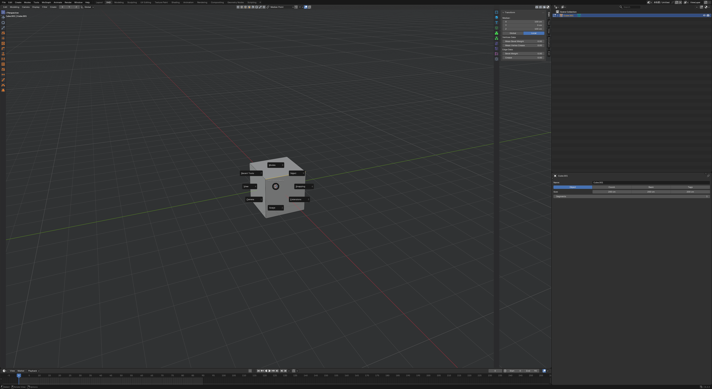
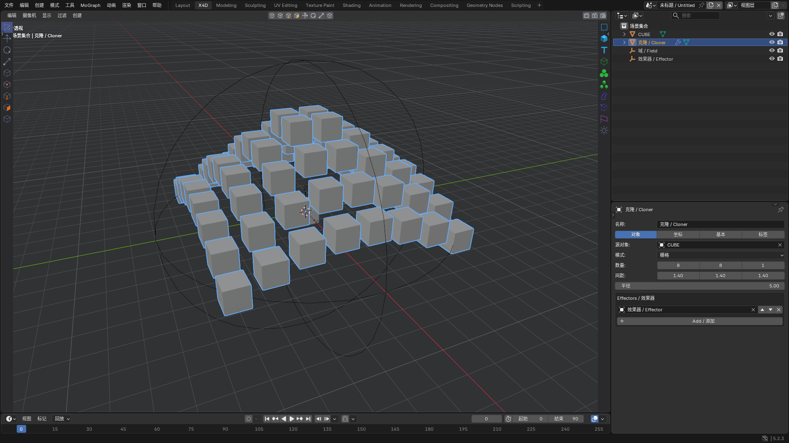
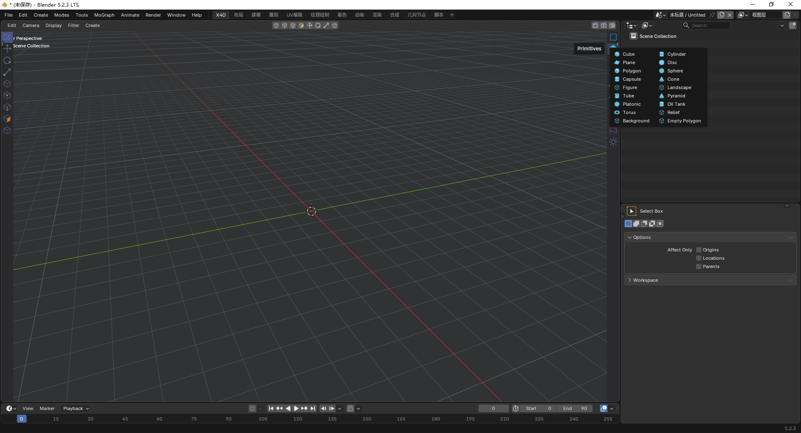

This extension is under development. Many features remain unfinished due to time constraints. I will keep improving it, and contributions are welcome to help complete its functionality.

# X4D Workflow Kit for Blender

[简体中文](README_ZH.md) · [Download](https://github.com/mmheart21-del/x4d-workflow-kit-for-blender/releases/tag/v0.7.6) · [Report an issue](https://github.com/mmheart21-del/x4d-workflow-kit-for-blender/issues) · GPL-3.0-or-later · Windows · Blender 4.5+ target

A Blender extension providing a dedicated workspace, compact creation palettes, modeling generators, deformers, MoGraph-style tools, fields and familiar navigation shortcuts. This independent project is under active development.

Prefer to keep your current interface and use only some X4D features? Take a look at [Swift 4D](https://plugins.laoma3d.xyz/p/1).

## Community & contributing

**GitHub is the primary home for X4D discussion, bug reports and development. No separate chat server is required.** Start with the [community guide](https://github.com/mmheart21-del/x4d-workflow-kit-for-blender/discussions/2).

| I want to… | Go to |
| --- | --- |
| Ask about installation or usage | [Q&A](https://github.com/mmheart21-del/x4d-workflow-kit-for-blender/discussions/categories/q-a) |
| Chat about workflows or share experiences | [General](https://github.com/mmheart21-del/x4d-workflow-kit-for-blender/discussions/categories/general) |
| Suggest or explore an idea | [Ideas](https://github.com/mmheart21-del/x4d-workflow-kit-for-blender/discussions/categories/ideas) |
| Share a creation or experiment | [Show and tell](https://github.com/mmheart21-del/x4d-workflow-kit-for-blender/discussions/categories/show-and-tell) |
| Report a reproducible bug or request a specific feature | [Issue forms](https://github.com/mmheart21-del/x4d-workflow-kit-for-blender/issues/new/choose) |
| Help fix, develop, optimize, test or document X4D | [Development collaboration](https://github.com/mmheart21-del/x4d-workflow-kit-for-blender/discussions/1) |
| Submit a code change for review | [Pull Requests](https://github.com/mmheart21-del/x4d-workflow-kit-for-blender/pulls) |
| Follow project updates | [Announcements](https://github.com/mmheart21-del/x4d-workflow-kit-for-blender/discussions/categories/announcements) |

Bug reports should include X4D/Blender versions, OS, steps to reproduce, expected/actual results and screenshots or error output. If unsure whether something is a bug, ask in Q&A first.

To contribute: discuss the approach → open or link an Issue → coordinate the task → submit a PR with test results → maintainer review and merge. Anyone can participate; participation does not automatically grant repository write access. See [CONTRIBUTING](CONTRIBUTING.md).

## Install

### Remote installation

1. Open the [X4D self-service page](https://plugins.laoma3d.xyz/p/2) and click **免费获取 (Get for Free)** to receive your repository URL and access token.
2. In Blender, open **Edit → Preferences → Get Extensions → Repositories**, add a remote repository, paste the URL and enter the access token.
3. Refresh the repository, find **X4D Workflow Kit**, and click **Install**. Use the same repository to check for and download updates.

### Install from disk

Download **x4d_workflow-0.7.6.zip**, then Preferences → Get Extensions → menu → Install from Disk. Enable the extension. Do not install the source archive as the extension.

An untouched factory startup enters a new empty scene. The original scene is preserved; existing edited or saved work is not cleared. Tools → Restore Blender restores managed theme/keymap state and switches back to the previous workspace. The extension never writes your startup file automatically.

The upper-right controls are Region Render, Render Current View and Render Settings. Drag a rectangle for region rendering; Esc cancels selection. Non-camera views use a temporary render camera that is removed when rendering finishes or is cancelled.

## Workflow

E / R / T: move / rotate / scale. H: frame all. S: frame selected. C: make editable. Alt+G: group. Alt+mouse or 1/2/3+left-drag: navigate. F1–F5: perspective/top/right/front/quad. M,T / M,S / U,A / U,I: command sequences. These shortcuts apply in the X4D workspace viewport. See the [shortcut reference](docs/SHORTCUTS.md) for command meanings and differences.

Minimum compatibility target is Blender 4.5. **Actual runtime tested: Windows, Blender 5.2.3 LTS.** Other versions and future releases are not claimed as tested. UI screenshots are from real Blender windows, not mockups.

Known differences include raster planar spline Booleans, mesh-boundary fog smoothing rather than voxel-density convolution, mesh-attribute vector smoothing rather than VDB vector grids, a 32-seed Voronoi limit, PCM WAV RMS rather than full spectral audio analysis, and approximate HPB rotation mapping. See the [Chinese documentation](README_ZH.md) for the complete feature matrix and limitations. No .x4d compatibility, Xpresso, renderer or simulation-system replication is provided.

Public PNG icons are original procedural drawings, reproducible with scripts/build_icons.py. Code and public icons use GPL-3.0-or-later. Blender is a trademark of its respective owner.
