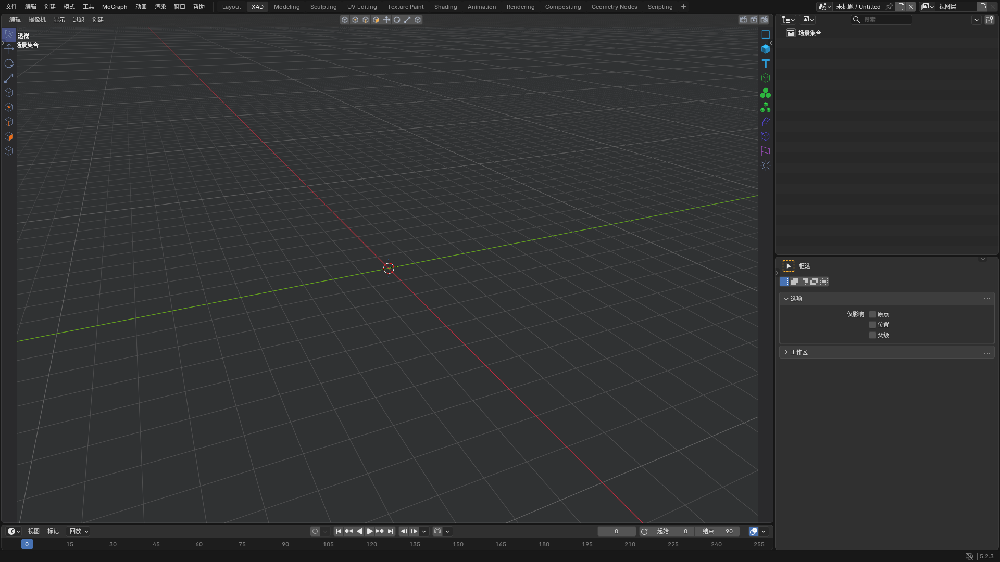
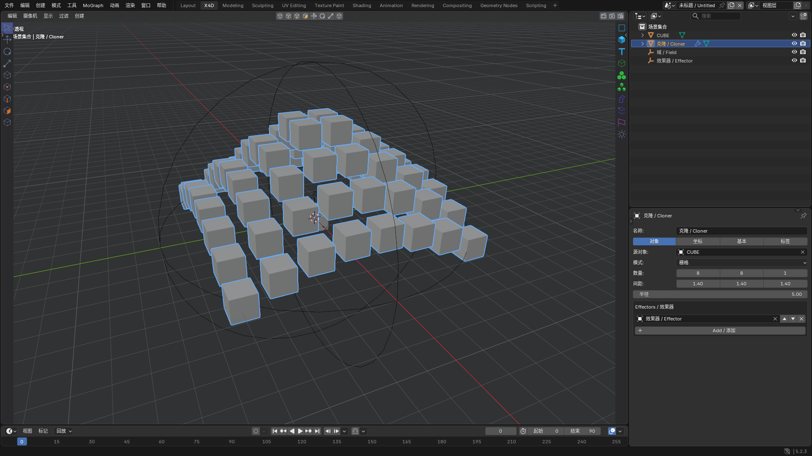

此插件正在开发中，因时间问题，还有很多功能未实现，我会继续优化。同时欢迎各位玩家踊跃参与，争取早日实现插件的全部功能

This extension is under development. Many features remain unfinished due to time constraints. I will keep improving it, and contributions are welcome to help complete its functionality.

# X4D Workflow Kit for Blender

[中文说明](README.md) · [Download](https://github.com/mmheart21-del/x4d-workflow-kit-for-blender/releases/tag/v0.6.1) · [Report an issue](https://github.com/mmheart21-del/x4d-workflow-kit-for-blender/issues) · GPL-3.0-or-later · Windows · Blender 4.5+ target

A Blender extension providing a dedicated workspace, compact creation palettes, modeling generators, deformers, MoGraph-style tools, fields and familiar navigation shortcuts. This independent project is under active development.

## Install

Download **x4d_workflow-0.6.1.zip**, then Preferences → Get Extensions → menu → Install from Disk. Enable the extension. Do not install the source archive as the extension.

An untouched factory startup enters a new empty scene. The original scene is preserved; existing edited or saved work is not cleared. Tools → Restore Blender restores managed theme/keymap state and switches back to the previous workspace. The extension never writes your startup file automatically.

The upper-right controls are Region Render, Render Current View and Render Settings. Drag a rectangle for region rendering; Esc cancels selection. Non-camera views use a temporary render camera that is removed when rendering finishes or is cancelled.

## Workflow

E / R / T: move / rotate / scale. H: frame all. S: frame selected. C: make editable. Alt+G: group. Alt+mouse or 1/2/3+left-drag: navigate. F1–F5: perspective/top/right/front/quad. M,T / M,S / U,A / U,I: command sequences. These shortcuts apply in the X4D workspace viewport.

Minimum compatibility target is Blender 4.5. **Actual runtime tested: Windows, Blender 5.2.3 LTS.** Other versions and future releases are not claimed as tested. UI screenshots are from real Blender windows, not mockups.

Known differences include raster planar spline Booleans, mesh-boundary fog smoothing rather than voxel-density convolution, mesh-attribute vector smoothing rather than VDB vector grids, a 32-seed Voronoi limit, PCM WAV RMS rather than full spectral audio analysis, and approximate HPB rotation mapping. See the Chinese README for the complete feature matrix and limitations. No .x4d compatibility, Xpresso, renderer or simulation-system replication is provided.

Public PNG icons are original procedural drawings, reproducible with scripts/build_icons.py. Code and public icons use GPL-3.0-or-later. Blender is a trademark of its respective owner.
