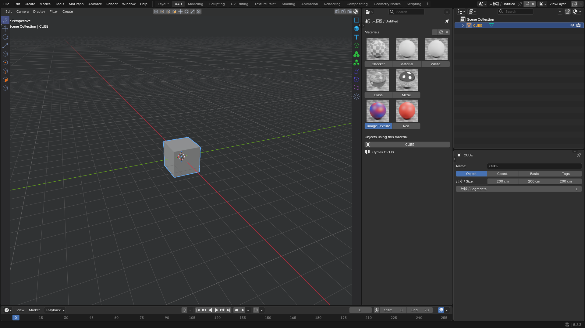
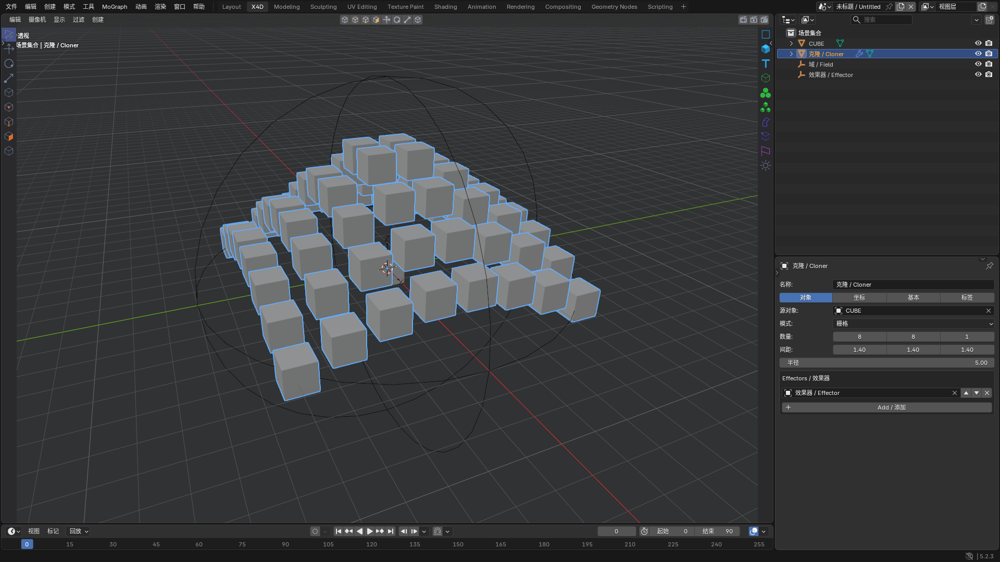
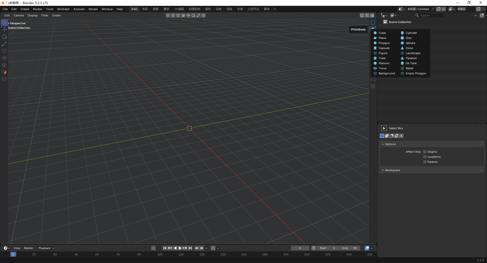

此插件正在开发中，因时间问题，还有很多功能未实现，我会继续优化。同时欢迎各位玩家踊跃参与，争取早日实现插件的全部功能

# X4D Workflow Kit — 0.6.1

[English](README.md) · [下载 0.6.1](https://github.com/mmheart21-del/x4d-workflow-kit-for-blender/releases/tag/v0.6.1) · [报告问题](https://github.com/mmheart21-del/x4d-workflow-kit-for-blender/issues)

Windows Blender 扩展。最低兼容目标为 Blender 4.5；实际运行测试版本为本机 Blender 5.2.3 LTS。运行时不需要 X4D、MCP 或网络。未来版本不视为已验证。

## 安装与恢复

在 Blender 的偏好设置 → 获取扩展 → 右上菜单 → 从磁盘安装，选择 `dist/x4d_workflow-0.6.1.zip`。更新前停用旧版，再安装新版并启用。请确认扩展版本显示 0.6.1。

首次启用创建独立 X4D 工作区并切换，布局会分几次刷新完成。识别到未保存、未编辑的 Blender 默认立方体/摄像机/灯光场景时，进入新的空场景，原场景保留。已编辑场景和已保存作品不清空。不自动保存当前文件、不覆盖启动文件。已有文件重开尊重保存布局。

恢复入口在顶部“工具 → 恢复 Blender”；也可在视口外用 Blender 操作搜索执行 Restore Blender。停用扩展会恢复接管的主题、快捷键与绘制入口；已有几何和原生修改器保留，但程序化对象需启用扩展才能继续更新。保留的 X4D 工作区可以手动删除。

## 本版变化

- 右上工具组替换为区域渲染、渲染、渲染设置。区域渲染拖框后执行，Esc 取消；非摄像机视图使用临时摄像机，渲染结束或取消后自动恢复。
- 工具悬停说明显示具体名称、用途与快捷键。
- 全新默认启动场景为空，不自动显示灯光、摄像机或立方体。

- 所有创建分类原先的“待实现”入口均已连接实际操作。需要输入对象或文件的命令会显示相应参数和提示。
- 公开版包含 131 个自行绘制的图标，采用熟悉的分类配色和几何语义；不包含 Maxon 原始图标。Blender 自带窗口控件仍存在。
- 初始布局按用户的原始截图调整：大视口、右侧上下管理器、窄时间条，无左侧渲染区。收起属性区导航与原生约束添加入口。
- 新增程序化几何、体积、破碎、域与效果器、声音、图片及 SVG 导入、显式运行的 Python 对象。
- 修正矩阵在已有选中对象时沿用源实例节点的问题、组件模式创建问题、重复变形累积和延迟效果器同帧漂移。

## 使用

右侧图标和顶部“创建”菜单打开分类面板。选中对象后，在右下属性区使用对象、坐标、基本、标签页。N 侧栏提供备用入口。生成器可先选输入对象再创建，也可使用输入列表。效果器拥有独立域列表，可排序、混合、反转、重映射。

声音工具使用 PCM WAV；浮雕和背景使用图片；IES 灯使用 IES 文件；矢量导入使用 SVG。Python 对象附带可运行示例，修改脚本后需点击“运行”；重开文件不会自动执行自定义脚本，已有生成网格保留。

快捷键包括 E/R/T、H/S、C、Alt+G、Alt 鼠标、1/2/3＋左键拖动、F1–F5、M,T / M,S / U,A / U,I，仅在 X4D 工作区的视口接管。坐标位置使用 X4D X,Y,Z = Blender X,Z,-Y，缩放交换 Y/Z；旋转仍为分量近似，不是完整 HPB 转换。

## 功能范围与差异

| 类别 | 当前实现 |
| --- | --- |
| 基础体、样条、文字、灯光 | 参数基础体、胶囊、管道、油罐、地形、人形、图像浮雕，采样曲线、公式曲线、轮廓、文字、原生灯光、IES 节点 |
| 生成器 | 子对象驱动细分、布尔、挤压、旋转、扫描、连接、对称、阵列、线框、减面、布料表面、放样、LOD、Python 网格 |
| 变形器 | 原生修改器与独立弯曲/扭曲/锥化控制器，公式位移、融解、碰撞投射、FFD 等 |
| MoGraph | 线性/径向/网格/表面克隆，矩阵、散布、分裂、Voronoi、追踪、运动样条、运动挤压、实例 |
| 效果器 | 简易、随机、步幅、延迟、公式、着色、声音、时间、目标、样条、Python；按列表叠加 |
| 域 | 线性、球、盒、随机、圆柱、圆锥、胶囊、圆环、着色、声音、公式、组域；组循环检测 |
| 体积 | 原生 Mesh to Volume / Volume to Mesh，网格 SDF 平滑、雾边界平滑、网格矢量属性平滑 |
| 标签、基础操作 | 材质、选择集、平滑、目标约束、分组、显隐、坐标、转可编辑和当前状态转对象 |

以下功能仍有实现限制，需要继续完善：

- 样条布尔使用平面栅格轮廓算法，精度取决于分辨率；不是精确样条布尔。
- 雾平滑先平滑输入网格边界再生成体积，不是密度体素卷积。矢量平滑处理网格上的 velocity/cw_velocity 属性，缺失时使用法线；不是 OpenVDB 矢量网格。
- Voronoi 使用网格半空间裁切与封口，最多 32 个种子；复杂非封闭网格不保证正确封口。
- 声音使用逐帧 PCM WAV RMS，不包含 X4D 的完整频谱分析。延迟依赖顺序播放历史，倒退时重置。
- SVG 导入支持几何路径和常用变换，不支持 AI、SVG 文字和完整 CSS。背景是相机前的图像平面。
- 生成器主要读取原始子网格/采样曲线，尚不保证任意嵌套修改器的完整求值或多源材质合并。部分变形器使用 Blender 修改器近似。
- Python API 为本扩展的 generate/effect 接口，不兼容 X4D Python API。自定义脚本需用户显式运行。
- 使用 Blender 材质与渲染器；不提供 .x4d 文件兼容，不包含完整 MoGraph、Xpresso 或模拟系统。

## 验证记录

Blender 5.2.3：108 个非文件选择创建菜单的执行检查；SVG/图片/WAV 单独检查；24 项几何检查、23 项域/效果器检查、8 项扩展工作流检查；注册失败回滚、重复启用、生成器/变形器回归；1,000 个实例及保存重开，10,000 实例生成耗时约 0.24 秒（本机测试场景，非交互帧率）。

测试脚本在 `tests/`，结果在 `artifacts/`。GUI 截图由实际 Blender 窗口通过 API 生成；不等于逐个按钮的人工鼠标验收。4.5 尚未运行实测；1080p 以外分辨率及 Windows 125%/150% 缩放需后续完整验收。

## 图标与许可

Python 代码和公开版自行绘制图标使用 GPL-3.0-or-later，完整许可证见 LICENSE。图标由 scripts/build_icons.py 生成，可独立重建，无需依赖其他三维软件。

X4D 是独立的 Blender 工作流扩展项目，与 Blender 官方无隶属关系。
